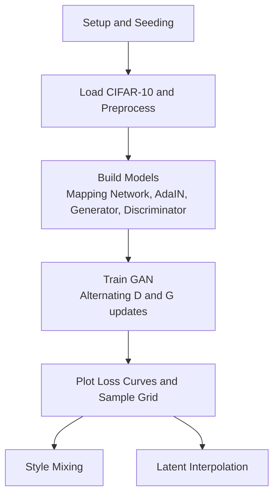
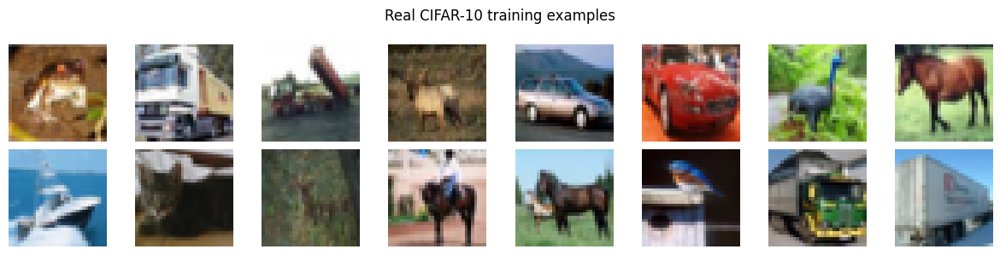
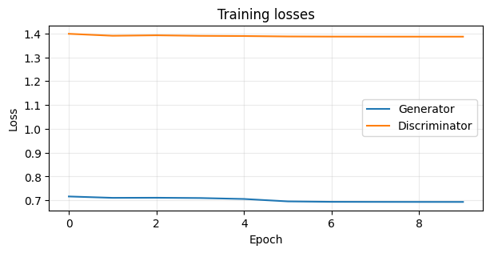
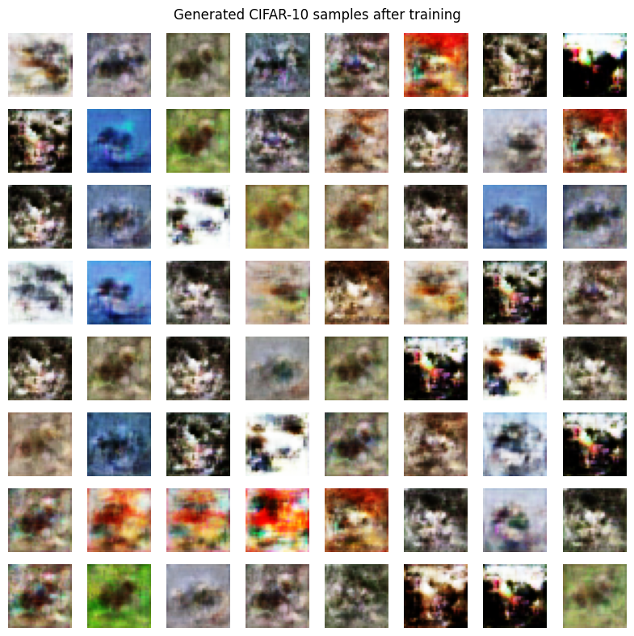
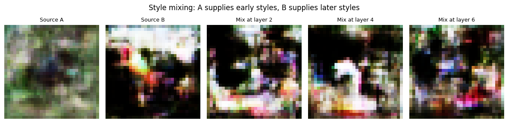
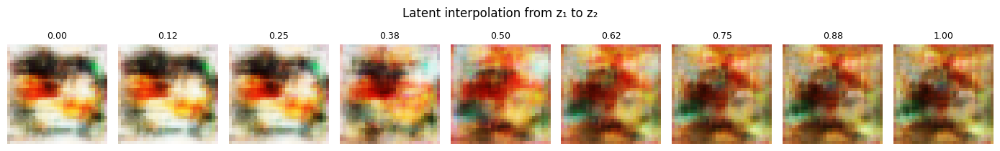

# Experiment 9 – Style-Based GAN (StyleGAN-lite) on CIFAR-10

## Aim
Implement a compact, StyleGAN-inspired generative adversarial network in TensorFlow/Keras, train it on CIFAR-10, and demonstrate style mixing and latent-space interpolation.

## What is a GAN?
A **Generative Adversarial Network (GAN)** consists of two neural networks trained against each other:

- **Generator (G):** takes random noise `z` and produces a fake image.
- **Discriminator (D):** looks at an image and predicts whether it is real (from the dataset) or fake (from G).

G tries to fool D, and D tries to catch G. As training progresses, G learns to produce images that look increasingly like the real data. At equilibrium, D can no longer tell real from fake (≈ 50% accuracy).

## What is StyleGAN?
**StyleGAN** keeps the GAN idea but redesigns the generator so that image features can be controlled at different levels. Instead of feeding noise directly into the network, it injects "styles" at every layer.

| Component | Role |
|---|---|
| **Mapping network** | 8 dense layers (LeakyReLU 0.2) map latent `z` → intermediate latent `w` (128-d), after input normalisation |
| **Learned constant input** | Synthesis starts from a learned 4×4×128 tensor instead of noise |
| **AdaIN** | Normalises feature maps, then scales/shifts them using a style derived from `w` |
| **Noise injection** | Per-layer learned noise strength adds stochastic fine detail |
| **Progressive resolution** | 4×4 → 8×8 → 16×16 → 32×32 (nearest-neighbour upsampling) |
| **Loss** | Non-saturating logistic GAN loss (softplus) |

Early layers control coarse structure (layout, colour blobs); later layers control finer details.

## Repository Structure
```
Experiment-9-StyleGAN-CIFAR10/
├── README.md
├── E0324051_Experiment_9.ipynb
├── requirements.txt
├── .gitignore
└── results/
    ├── real_samples.png
    ├── training_losses.png
    ├── generated_samples.png
    ├── style_mixing.png
    └── latent_interpolation.png
```

| File / Folder | Purpose |
|---|---|
| `README.md` | Project documentation |
| `E0324051_Experiment_9.ipynb` | Main notebook: model, training, style mixing, interpolation |
| `requirements.txt` | Python dependencies (`tensorflow`, `numpy`, `matplotlib`) |
| `.gitignore` | Excludes checkpoints, cache and model files from Git |
| `results/` | Output figures used in this README |

## Dataset
- **CIFAR-10**, first **20,000** training images (deterministic subset)
- Pixels scaled to **[-1, 1]**
- Batch size **64**

## Model Summary
| Model | Parameters |
|---|---|
| Generator | 1,044,651 |
| Discriminator | 428,385 |

Generator channels per resolution: `{4: 128, 8: 128, 16: 64, 32: 32}`; RGB output via 1×1 conv + `tanh`.

## Training Setup
| Setting | Value |
|---|---|
| Framework | TensorFlow 2.21.0 (GPU) |
| Dataset subset | 20,000 images |
| Batch size | 64 |
| Epochs | 10 |
| Optimizer | Adam (lr = 2e-4, β₁ = 0.0, β₂ = 0.99), for both G and D |
| Loss | Non-saturating logistic (softplus) |
| Latent size (`z`, `w`) | 128 |
| Random seed | 42 |
| Training time | ~129 s |

## Workflow


## Results

### Training Loss per Epoch
| Epoch | Discriminator Loss | Generator Loss |
|---|---|---|
| 1 | 1.398 | 0.716 |
| 2 | 1.390 | 0.711 |
| 3 | 1.392 | 0.711 |
| 4 | 1.390 | 0.710 |
| 5 | 1.389 | 0.706 |
| 6 | 1.387 | 0.696 |
| 7 | 1.387 | 0.694 |
| 8 | 1.387 | 0.694 |
| 9 | 1.386 | 0.693 |
| 10 | 1.386 | 0.693 |

Losses converge to D ≈ 1.386 (2·ln 2) and G ≈ 0.693 (ln 2), meaning the discriminator is near chance on real vs. fake.

### Real CIFAR-10 Samples


### Training Losses


### Generated Samples


### Style Mixing
Image A supplies early (coarse) styles and image B supplies later (fine) styles, with the switch at layers 2, 4 and 6.



### Latent Interpolation
Nine linearly interpolated steps between two latent vectors `z₁` and `z₂`.



## Observations
- Early-layer styles control coarse structure; later-layer styles affect finer appearance.
- Smooth latent interpolation shows the generator learned a continuous latent space.
- Losses are almost flat from epoch 1, so the model is under-trained: 10 epochs on 20k images is a classroom-scale run, and samples are low-fidelity compared to full StyleGAN.

## Tech Stack
Python · TensorFlow/Keras · NumPy · Matplotlib
